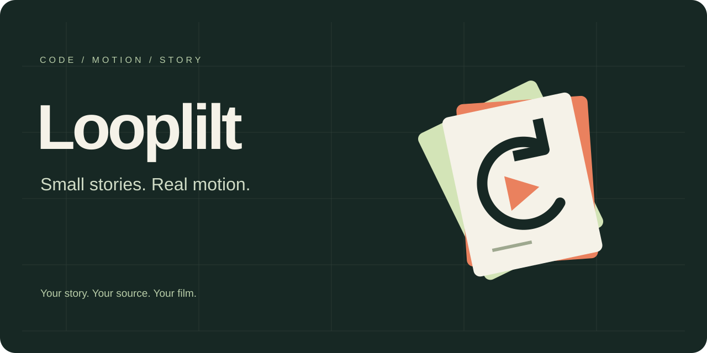
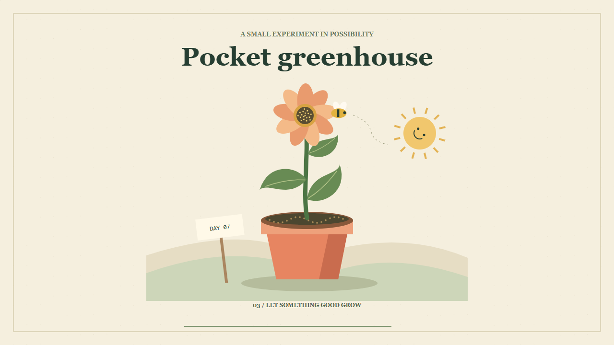
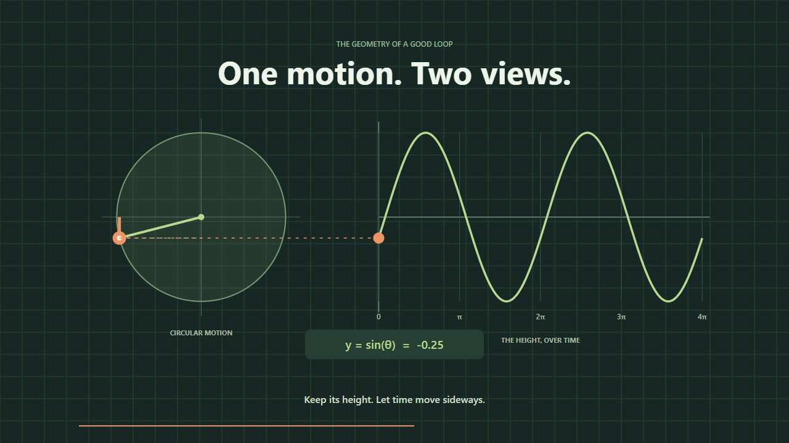
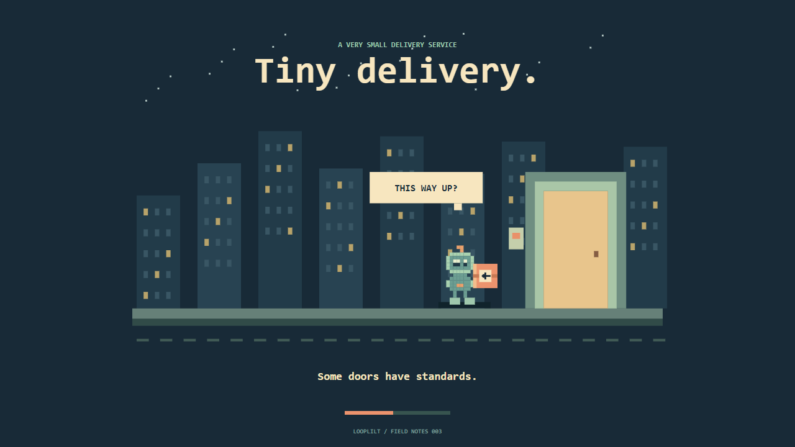

<p align="center"></p>

<p align="center"><strong>A little studio for ideas that move.</strong></p>
<p align="center">Editable Canvas scenes → a player you can scrub → a film you can share.</p>
<p align="center"><a href="https://alaanfissi.github.io/Looplilt/">Visit the screening room ↗</a> &nbsp; · &nbsp; <a href="#quick-start">Make your first film</a> &nbsp; · &nbsp; <a href="docs/authoring.md">Drawing guide</a> &nbsp; · &nbsp; <a href="LICENSE">MIT licensed</a></p>

Looplilt is a small animation toolkit by **Alaa Nfissi**. A project has two files: a timeline in `project.json` and a drawing in `draw.js`. Change a shape, move a beat, add a score, and see the result in a self-contained HTML player. When it feels right, export an MP4.

**Draw it. Give it rhythm. Make it a film.** Everything runs on your computer. The project stays small, the source stays editable, and the finished film is yours to share.

The examples, illustrations, characters, and scores in this repository were created for Looplilt. Open one, change something, and make it yours.

## The screening room

Three working projects. Three different visual languages. Each one is an invitation to try something.

| Paper world | Visual explanation | Pixel comedy |
| --- | --- | --- |
| [](https://alaanfissi.github.io/Looplilt/play/paper-garden.html) | [](https://alaanfissi.github.io/Looplilt/play/orbit-to-wave.html) | [](https://alaanfissi.github.io/Looplilt/play/tiny-delivery.html) |
| [Pocket greenhouse](examples/paper-garden) — a seed becomes a paper flower. | [One motion. Two views.](examples/orbit-to-wave) — an orbit traces a wave. | [Tiny delivery](examples/tiny-delivery) — a robot learns to read the box. |

Each film is 16 seconds, with an original procedural score. [Watch and download the wide and vertical versions](https://alaanfissi.github.io/Looplilt/#films).

| Make it yours | Keep the creative loop short |
| --- | --- |
| **A drawing you can change** | Two project files, normal Canvas APIs, and time you can reason about. |
| **A preview you can pass around** | One self-contained HTML file with playback, seeking, and sound. |
| **A film you can take anywhere** | Local H.264 export, three frame formats, captions, and your narration. |

## Quick start

Install [Node.js 22 or newer](https://nodejs.org/). HTML previews use only Node's built-in modules.

```sh
git clone https://github.com/alaaNfissi/Looplilt.git
cd Looplilt
node bin/looplilt.mjs init my-film
node bin/looplilt.mjs build my-film --out my-film.html
```

Open `my-film.html` in a browser. Press **Play**, then **Sound off** to turn the score on. Edit `my-film/draw.js`, rebuild with a new output filename, and scrub the result. Generated files are never overwritten.

Choose another starting point with `--example orbit-to-wave` or `--example tiny-delivery`. No account, service key, or hosted rendering service is needed.

## Export video

Install [FFmpeg and FFprobe](https://ffmpeg.org/download.html) and make them available on `PATH`. Then install the pinned browser dependency:

```sh
npm ci
npm run setup
node bin/looplilt.mjs doctor
node bin/looplilt.mjs render my-film --out output/my-film.mp4
node bin/looplilt.mjs render my-film --format portrait --out output/my-film-tall.mp4
```

The renderer captures exact frames, then encodes H.264 video with AAC audio. It checks seek-order repeatability before rendering and decodes the finished MP4 to check for errors. Canvas capture and H.264 encoding use portable defaults; this version has no GPU-specific encoder option.

| Format | Resolution |
| --- | --- |
| `landscape` | 1280 × 720 |
| `portrait` | 720 × 1280 |
| `square` | 960 × 960 |

Scenes receive the actual dimensions and can recompose for each format. They are not automatically cropped from one master frame.

## What is inside

- **A direct drawing API:** `drawFrame({ ctx, w, h, t, progress, frame, portrait })`. Use normal Canvas paths, text, transforms, and compositing.
- **A portable player:** one HTML file with a timeline, play/pause, restart, sound, and no external runtime requests.
- **A small score synthesizer:** MIDI pitches, four voices, and deterministic PCM output. No sampled instruments or music downloads.
- **Captions and narration:** timed caption cues drawn into the film, WebVTT export, and an optional local narration track. Voice recording or speech synthesis happens outside Looplilt.
- **A review path:** six-panel storyboards, exact frame sampling, format checks, and full video decoding.
- **A coding-assistant skill:** reusable authoring guidance for compatible local environments. Plain JavaScript works just as well by hand.

```sh
node bin/looplilt.mjs storyboard my-film --out output/storyboard.png
node bin/looplilt.mjs captions my-film --out output/captions.vtt
node bin/looplilt.mjs sound my-film --out output/score.wav
node bin/looplilt.mjs render my-film --narration voice.wav --out output/narrated.mp4
node bin/looplilt.mjs check output/narrated.mp4
```

## Use with Codex, ChatGPT, or another coding assistant

Open the repository in a local coding environment and ask it to follow [the Looplilt skill](skills/looplilt/SKILL.md). For Codex project discovery, copy the `skills/looplilt` folder into `.agents/skills/looplilt`; the skill asks the environment to locate this repository before running its CLI.

Example prompt:

> Use Looplilt to explain how a bicycle gear changes speed. Make a 30-second visual story with a moving chain and two changing gear sizes. Compose wide and vertical versions, add a quiet score, and show me a storyboard before the final export.

ChatGPT needs an environment that can edit files and run Node, a browser, and FFmpeg to render locally. In a chat without those tools, it can write the two project files for you to run on your computer. An instruction file does not add execution tools or voice services.

## Learn and contribute

- [Authoring](docs/authoring.md): timing, composition, captions, scores, and project data.
- [Local tools](docs/tools.md): environment variables, troubleshooting, and testing.
- [Architecture](docs/architecture.md): how the player and renderer fit together.
- [Contributing](CONTRIBUTING.md): focused improvements and original examples.
- [Validation](docs/validation.md): what is checked and what still needs a human eye.
- [Brand kit](docs/brand.md): editable logos, colors, repository cover, and social artwork.

```sh
npm test
npm run test:browser
npm run site
npm run pack
```

Looplilt 0.1 is intentionally small. It supports trusted, self-contained Canvas projects up to ten minutes at 1–60 fps. It is not a timeline editor, a 3D engine, or a hosted media service. Rendering time and temporary storage grow with resolution and frame count; test a short section first.

## License

Copyright © 2026 **Alaa Nfissi**. Project code, original example drawings, and scores are available under the [MIT license](LICENSE). Separately installed tools and dependencies retain their own licenses.
