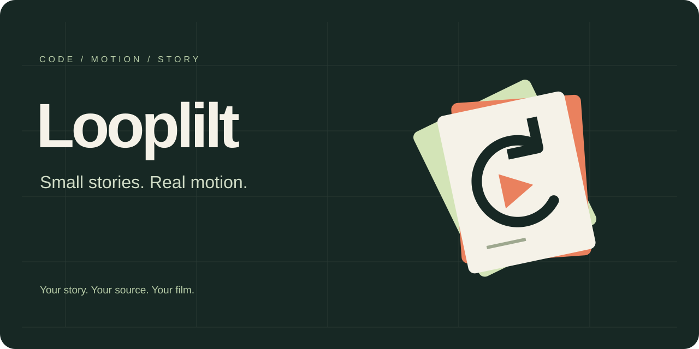
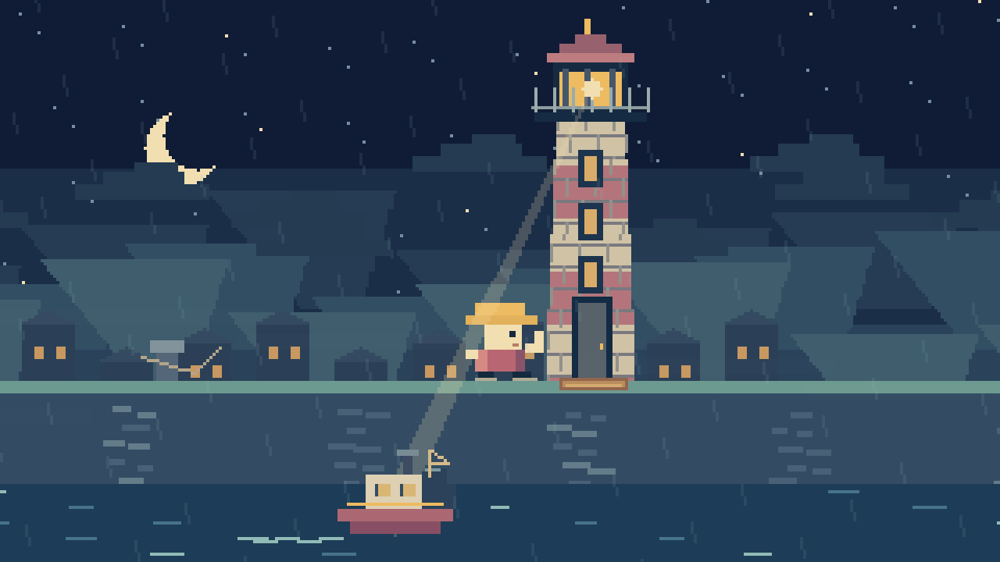
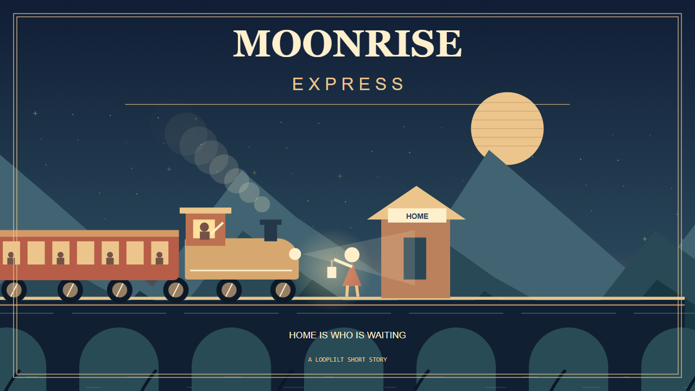
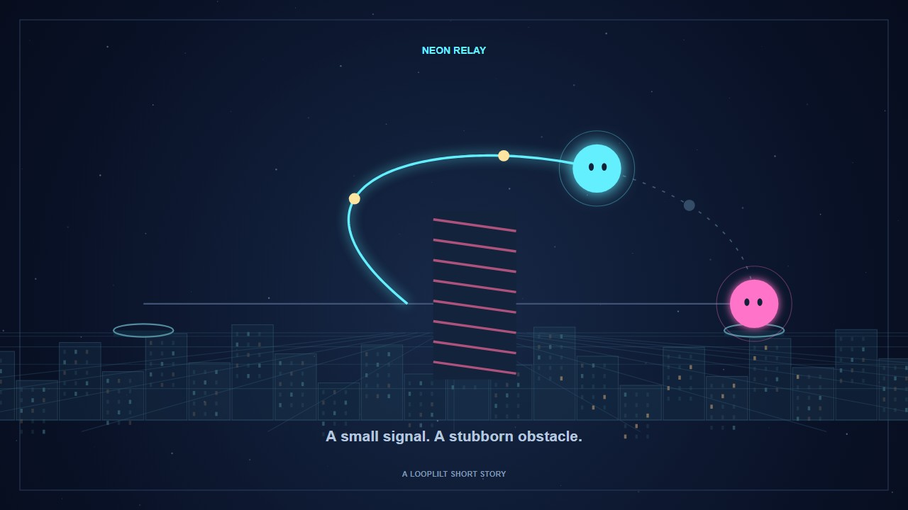
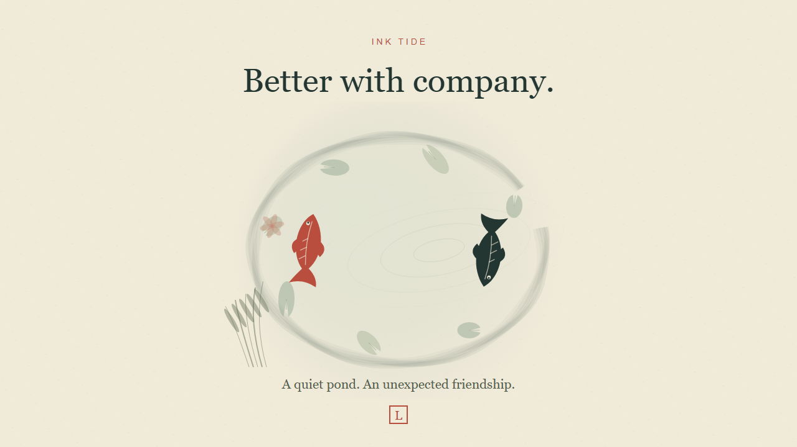
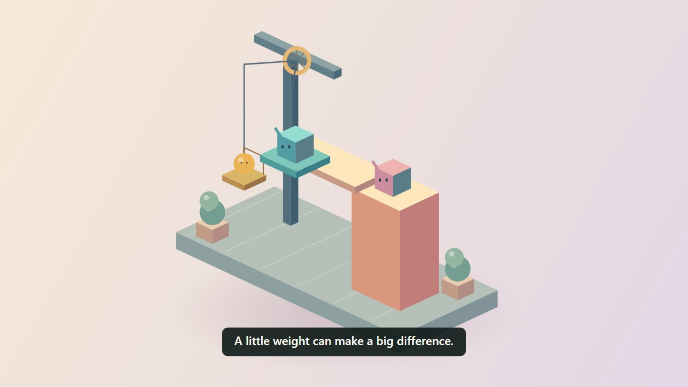
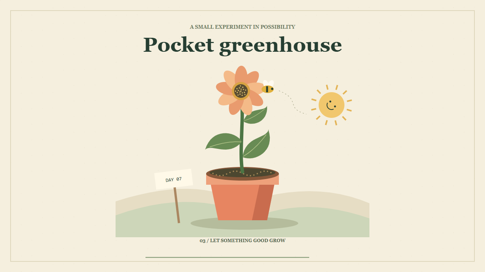
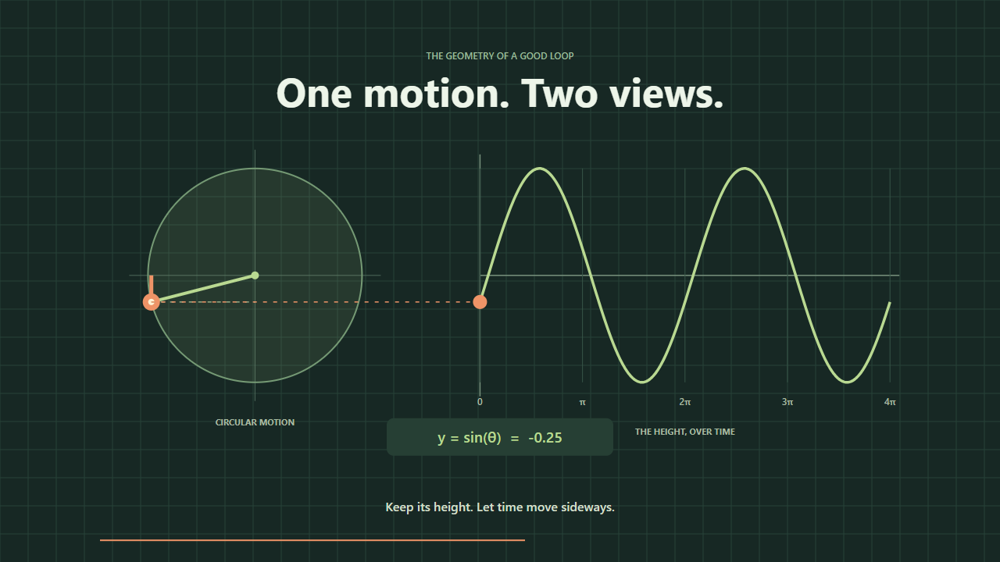
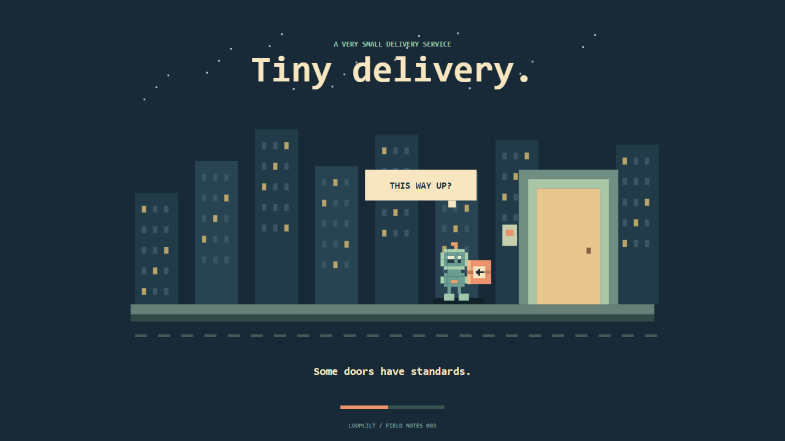

<p align="center"></p>

<p align="center"><strong>An open-source JavaScript toolkit for small animated films.</strong></p>
<p align="center">Editable Canvas scenes → a player you can scrub → a film you can share.</p>
<p align="center"><a href="https://looplilt.com/">Visit the screening room ↗</a> &nbsp; · &nbsp; <a href="#quick-start">Make your first film</a> &nbsp; · &nbsp; <a href="docs/authoring.md">Drawing guide</a> &nbsp; · &nbsp; <a href="LICENSE">MIT licensed</a></p>

Looplilt is a small animation toolkit by **Alaa Nfissi**. A project has two files: a timeline in `project.json` and a drawing in `draw.js`. Change a shape, move a beat, add a score, and see the result in a self-contained HTML player. When it feels right, export an MP4.

**Draw it. Give it rhythm. Make it a film.** Everything runs on your computer. The project stays small, the source stays editable, and the finished film is yours to share.

The examples, illustrations, characters, and scores in this repository were created for Looplilt. Open one, change something, and make it yours.

## The screening room

Nine original films, from a five-shot lighthouse adventure to a quiet ink-paper encounter. The six new stories pair richer staging with distinct stereo arrangements; the three compact starters make the fundamentals easy to explore.

| Pixel adventure · 40s | Jazz-club comedy · 36s | Art Deco postcard · 24s |
| --- | --- | --- |
| [](https://looplilt.com/play/one-more-light.html) | [](https://looplilt.com/play/the-missing-beat.html) | [](https://looplilt.com/play/moonrise-express.html) |
| [One More Light](examples/one-more-light) — a keeper restores the beacon before a boat loses its way. | [The Missing Beat](examples/the-missing-beat) — a quiet newcomer finds a place in the band. | [Moonrise Express](examples/moonrise-express) — the last train follows a small light home. |

| Luminous motion · 24s | Ink on paper · 22s | Isometric miniature · 24s |
| --- | --- | --- |
| [](https://looplilt.com/play/neon-relay.html) | [](https://looplilt.com/play/ink-tide.html) | [](https://looplilt.com/play/the-little-lift.html) |
| [Neon Relay](examples/neon-relay) — a detour becomes a connection. | [Ink Tide](examples/ink-tide) — a leaf turns into unexpected company. | [The Little Lift](examples/the-little-lift) — a small helper brings two friends together. |

| Paper-world starter · 16s | Explanation starter · 16s | Pixel-comedy starter · 16s |
| --- | --- | --- |
| [](https://looplilt.com/play/paper-garden.html) | [](https://looplilt.com/play/orbit-to-wave.html) | [](https://looplilt.com/play/tiny-delivery.html) |
| [Pocket greenhouse](examples/paper-garden) — a seed becomes a paper flower. | [One motion. Two views.](examples/orbit-to-wave) — an orbit traces a wave. | [Tiny delivery](examples/tiny-delivery) — a robot learns to read the box. |

Each film has original artwork and a procedural score. [Watch and download wide and vertical versions](https://looplilt.com/#films). Read the [capability tour](docs/showcase.md) for the techniques, project files, and limits behind the films.

| Make it yours | Keep the creative loop short |
| --- | --- |
| **A drawing you can change** | Two project files, normal Canvas APIs, and time you can reason about. |
| **A preview you can pass around** | One self-contained HTML file with playback, seeking, and sound. |
| **A film you can take anywhere** | Local H.264 export, three frame formats, captions, and your narration. |

## Quick start

Try the [Pocket greenhouse remixer](https://looplilt.com/remix/) to change colors, words, and pacing in your browser, then download the actual editable project. No installation or account is needed for that first creative step. MP4 export runs locally.

**This branch is a development candidate.** The remixer and new installer will become public after review and deployment. The published [v0.1.0 release](https://github.com/alaaNfissi/Looplilt/releases/tag/v0.1.0) remains unchanged. To preview this branch locally, run `npm run site` and serve `.site/` with a local HTTP server.

Install [Node.js 22 or newer](https://nodejs.org/). HTML previews use only Node's built-in modules.

```sh
git clone https://github.com/alaaNfissi/Looplilt.git
cd Looplilt
node bin/looplilt.mjs init my-film
node bin/looplilt.mjs build my-film --out my-film.html
```

Open `my-film.html` in a browser. Press **Play**, then **Sound off** to turn the score on. Edit `my-film/draw.js`, rebuild with a new output filename, and scrub the result. Generated files are never overwritten.

Choose any gallery project by its folder name, for example `--example one-more-light`, `--example the-missing-beat`, or `--example ink-tide`. The 26-second [launch film](examples/little-idea) is also available as `--example little-idea`. No account, service key, or hosted rendering service is needed.

## Export video

Install [FFmpeg and FFprobe](https://ffmpeg.org/download.html) and make them available on `PATH`. Then install the pinned browser dependency:

```sh
npm ci
npm run setup
node bin/looplilt.mjs doctor
node bin/looplilt.mjs render my-film --out output/my-film.mp4
node bin/looplilt.mjs render my-film --format portrait --out output/my-film-tall.mp4
```

The renderer captures exact frames, then encodes H.264 video with AAC audio. It checks seek-order repeatability before rendering and decodes the finished MP4 to check for errors. Canvas capture and H.264 encoding use portable defaults; this version has no GPU-specific encoder option.

| Format | Resolution |
| --- | --- |
| `landscape` | 1280 × 720 |
| `portrait` | 720 × 1280 |
| `square` | 960 × 960 |

Scenes receive the actual dimensions and can recompose for each format. They are not automatically cropped from one master frame.

## What is inside

- **A direct drawing API:** `drawFrame({ ctx, w, h, t, progress, frame, portrait })`. Use normal Canvas paths, text, transforms, and compositing.
- **A portable player:** one HTML file with a timeline, play/pause, restart, sound, and no external runtime requests.
- **An optional stereo sound studio:** 20 synthesized voices, instrument layers, panning, room reflections, echo, and environmental effects. Existing mono scores remain compatible. [Compose a score](docs/audio.md).
- **Captions and narration:** timed caption cues drawn into the film, WebVTT export, and an optional local narration track. Voice recording or speech synthesis happens outside Looplilt.
- **A review path:** six-panel storyboards, exact frame sampling, format checks, and full video decoding.
- **A coding-assistant skill:** reusable authoring guidance for compatible local environments. Plain JavaScript works just as well by hand.

```sh
node bin/looplilt.mjs storyboard my-film --out output/storyboard.png
node bin/looplilt.mjs captions my-film --out output/captions.vtt
node bin/looplilt.mjs sound my-film --out output/score.wav
node bin/looplilt.mjs render my-film --narration voice.wav --out output/narrated.mp4
node bin/looplilt.mjs check output/narrated.mp4
```

## Let your coding agent set it up

Copy this prompt into a coding agent with local file and terminal access. The [setup guide](docs/agents.md) explains portable skill installation and platform limitations.

<!-- SETUP_PROMPT_START -->
```text
Set up Looplilt for me in this workspace so we can make editable animated films together.

Use the official repository: https://github.com/alaaNfissi/Looplilt. Reuse a healthy existing checkout or clone it into a new Looplilt folder, preserving my existing files. Check for Git and Node.js 22 or newer; use the installation instructions for my operating system if either is missing. Read the checkout's README and skills/looplilt/SKILL.md.

Make the Looplilt skill available to this coding agent at project scope. If scripts/install-skill.mjs exists, run it with this agent's project skill directory as the destination; for Codex that is .agents/skills/looplilt in my workspace. This installs a portable copy with its runtime. If that command is unavailable, follow the skill explicitly from the checkout and tell me its location. Do not claim that a skill adds execution tools or that it was discovered unless you verified that.

Create a new my-first-loop project and build a standalone HTML preview with Looplilt's CLI. HTML needs only Node; do not make browser or video dependencies a prerequisite. Open the preview if your tools permit, check playback and seeking, and give me the exact project and player paths. If you cannot inspect playback, say so.

Finish by telling me how to ask for a change to the film. If I request MP4 export, set up the pinned Chromium dependency and FFmpeg/FFprobe, run doctor, render a short film, and verify it with check. Do not publish anything or overwrite an existing project. Ask only for missing choices or permissions that actually block setup.
```
<!-- SETUP_PROMPT_END -->

## Create with your coding assistant

Open the repository in a local coding environment and ask it to follow [the Looplilt skill](skills/looplilt/SKILL.md). For a portable Codex installation, run `node scripts/install-skill.mjs ../.agents/skills/looplilt` from the checkout. This creates a new project skill folder with the runtime included. See [other installation routes](docs/agents.md); an instruction-only installer does not install the CLI.

Example prompt:

> Use Looplilt to explain how a bicycle gear changes speed. Make a 30-second visual story with a moving chain and two changing gear sizes. Compose wide and vertical versions, add a quiet score, and show me a storyboard before the final export.

ChatGPT needs an environment that can edit files and run Node, a browser, and FFmpeg to render locally. In a chat without those tools, it can write the two project files for you to run on your computer. An instruction file does not add execution tools or voice services.

## Learn and contribute

- [Authoring](docs/authoring.md): timing, composition, captions, scores, and project data.
- [Sound studio](docs/audio.md): voices, stereo placement, room sound, composition, and narration.
- [Capability tour](docs/showcase.md): original films, techniques, and useful starting points.
- [Local tools](docs/tools.md): environment variables, troubleshooting, and testing.
- [Architecture](docs/architecture.md): how the player and renderer fit together.
- [Contributing](CONTRIBUTING.md): focused improvements and original examples.
- [Validation](docs/validation.md): what is checked and what still needs a human eye.
- [Official domain](docs/domain.md): GitHub Pages, DNS, HTTPS, and the transition checklist.
- [Brand kit](docs/brand.md): editable logos, colors, repository cover, and social artwork.
- [Remixer design](docs/remixer.md): trusted parameters, source downloads, and preview parity.
- [Share a creation](docs/community.md): a small, new showcase initiative built around working films.
- [Launch preparation](docs/launch/README.md): assessment, decisions, media, channel drafts, and quality evidence.

```sh
npm test
npm run test:browser
npm run site
npm run pack
```

Looplilt is intentionally small. It supports trusted, self-contained Canvas projects up to ten minutes at 1–60 fps. It is not a timeline editor, a 3D engine, or a hosted media service. Rendering time and temporary storage grow with resolution and frame count; test a short section first.

## License

Copyright © 2026 **Alaa Nfissi**. Project code, original example drawings, and scores are available under the [MIT license](LICENSE). Separately installed tools and dependencies retain their own licenses.
