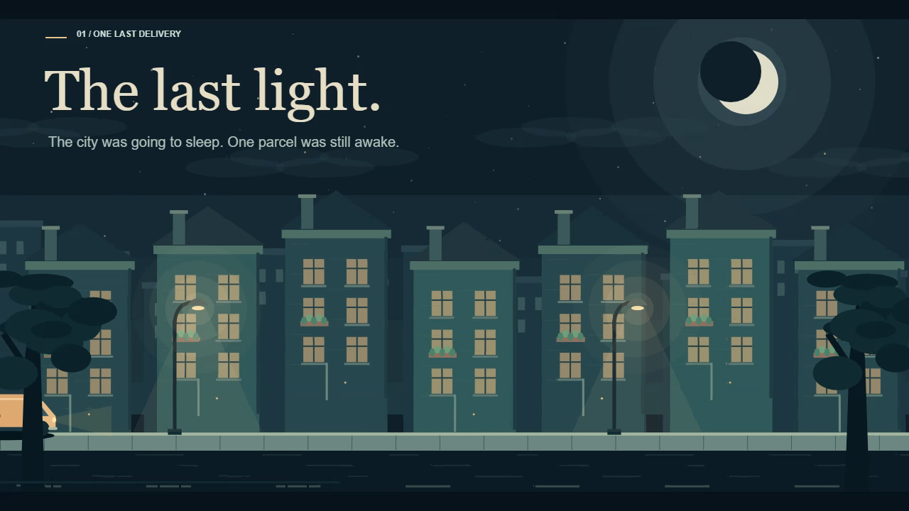
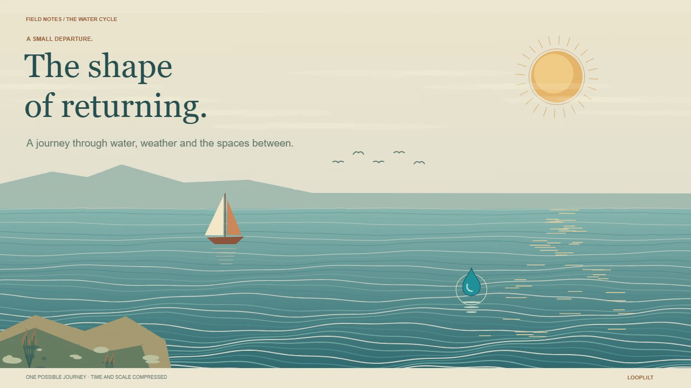
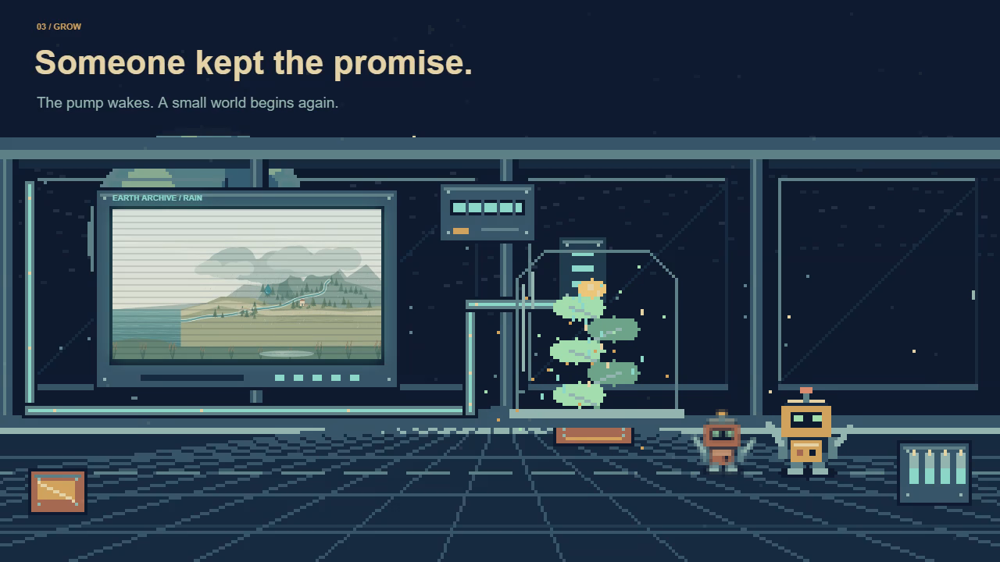
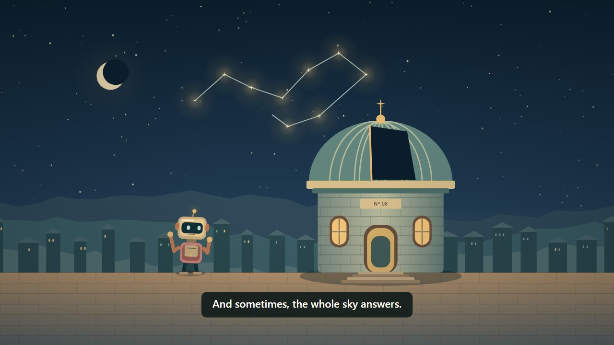
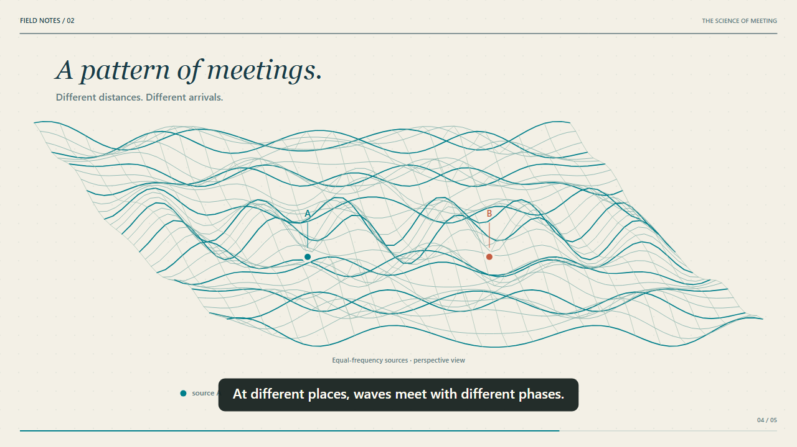
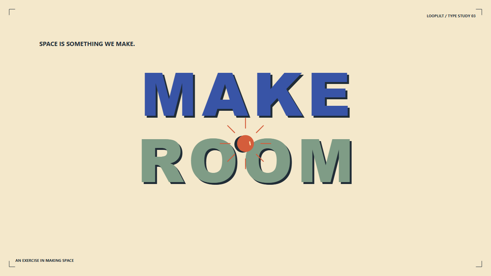

<p align="center"></p>

<p align="center"><strong>An open-source creative studio for editable animated films.</strong></p>
<p align="center">Create in Studio. Refine with code or an agent. Keep every layer.</p>
<p align="center"><a href="https://looplilt.com/studio/">Open Studio ↗</a> &nbsp; · &nbsp; <a href="#quick-start">Make your first film</a> &nbsp; · &nbsp; <a href="docs/authoring.md">Drawing guide</a> &nbsp; · &nbsp; <a href="LICENSE">MIT licensed</a></p>

Looplilt brings visual editing, code and AI agents into one local-first creative workflow. Arrange footage and editable layers in **Studio**, animate a scene through the **graph API**, or ask an agent to make a precise change through **MCP**. They share the same project, with revision checks, portable files and local video export.

Made by **Alaa Nfissi**, and open to everyone who wants to contribute. No account or hosted rendering service is required. The original two-file Canvas workflow remains supported, including its drawings, standalone HTML players and procedural scores.

## Watch it. Open it. Make it yours.

Three new original films demonstrate different visual languages and musical arrangements. Each opens as an editable copy in Studio; the artwork, score and reproducible source are included.

| Cinematic vector illustration · 48s | Illustrated scientific fieldbook · 60s | Pixel art × moving-image collage · 52s |
| --- | --- | --- |
| [](https://looplilt.com/#studio-films) | [](https://looplilt.com/#studio-films) | [](https://looplilt.com/#studio-films) |
| A last delivery wakes a sleeping street. Piano, strings, guitar and brushed percussion. | Water returns through ocean, clouds, rain and underground passages. Fingerpicked guitar, marimba and atmospheric sound. | A tiny caretaker reconnects a silent station. Syncopated bass, piano, drums and a chiptune counterpoint. |
| [Open editable film](https://looplilt.com/studio/?story=the-last-light) · [Source](examples/studio/the-last-light) | [Open editable film](https://looplilt.com/studio/?story=the-shape-of-returning) · [Source](examples/studio/the-shape-of-returning) | [Open editable film](https://looplilt.com/studio/?story=a-signal-for-the-garden) · [Source](examples/studio/a-signal-for-the-garden) |

The Last Light has individually editable vector layers. The other two preserve their procedural artwork as editable drawing source, alongside separate titles, media, effects and audio; Studio does not turn arbitrary drawing code into individual vector objects.

## The screening room

Twelve more original Canvas films, from a clockwork observatory to a wave experiment and expressive kinetic type. Three compact starters keep the fundamentals approachable; the larger films show staging, responsive composition, and distinct musical arrangements.

**Visual styles:** clockwork storybook, scientific visualization, kinetic typography, pixel art, illustration, Art Deco, motion graphics, ink & wash, isometric, paper cutout, and mathematical visualization. [Filter the screening room by style](https://looplilt.com/#films); open “Inside this film” for the drawing techniques and original score.

| Clockwork storybook · 32s | Scientific visualization · 32s | Kinetic typography · 28s |
| --- | --- | --- |
| [](https://looplilt.com/play/brass-observatory.html) | [](https://looplilt.com/play/the-quiet-between.html) | [](https://looplilt.com/play/make-room.html) |
| [The Brass Observatory](examples/brass-observatory) — a small repair opens a wider sky. | [The Quiet Between](examples/the-quiet-between) — an experiment in the way waves meet. | [Make Room](examples/make-room) — change the arrangement, open a way. |

| Pixel adventure · 40s | Jazz-club comedy · 36s | Art Deco postcard · 24s |
| --- | --- | --- |
| [](https://looplilt.com/play/one-more-light.html) | [](https://looplilt.com/play/the-missing-beat.html) | [](https://looplilt.com/play/moonrise-express.html) |
| [One More Light](examples/one-more-light) — a keeper restores the beacon before a boat loses its way. | [The Missing Beat](examples/the-missing-beat) — a quiet newcomer finds a place in the band. | [Moonrise Express](examples/moonrise-express) — the last train follows a small light home. |

| Luminous motion · 24s | Ink on paper · 22s | Isometric miniature · 24s |
| --- | --- | --- |
| [](https://looplilt.com/play/neon-relay.html) | [](https://looplilt.com/play/ink-tide.html) | [](https://looplilt.com/play/the-little-lift.html) |
| [Neon Relay](examples/neon-relay) — a detour becomes a connection. | [Ink Tide](examples/ink-tide) — a leaf turns into unexpected company. | [The Little Lift](examples/the-little-lift) — a small helper brings two friends together. |

| Paper-world starter · 16s | Explanation starter · 16s | Pixel-comedy starter · 16s |
| --- | --- | --- |
| [](https://looplilt.com/play/paper-garden.html) | [](https://looplilt.com/play/orbit-to-wave.html) | [](https://looplilt.com/play/tiny-delivery.html) |
| [Pocket greenhouse](examples/paper-garden) — a seed becomes a paper flower. | [One motion. Two views.](examples/orbit-to-wave) — an orbit traces a wave. | [Tiny delivery](examples/tiny-delivery) — a robot learns to read the box. |

Each film has original artwork and a procedural score. [Watch and download wide and vertical versions](https://looplilt.com/#films). Read the [capability tour](docs/showcase.md) for the techniques, project files, and limits behind the films.

| Make it yours | Keep the creative loop short |
| --- | --- |
| **A drawing you can change** | Two project files, normal Canvas APIs, and time you can reason about. |
| **A preview you can pass around** | One self-contained HTML file with playback, seeking, and sound. |
| **A film you can take anywhere** | Local H.264 export, three frame formats, captions, and your narration. |

## Studio, code and agents

Looplilt Studio adds a visual timeline, editable layers, motion paths, masks, constraints, media import, audio mixing and MP4/WebM export. The same graph powers Studio, the CLI and the local MCP server. An agent can inspect a saved revision, change one object and compare what changed while a person keeps editing.

[Studio guide](docs/studio.md) · [Scene graph](docs/scene-graph.md) · [MCP setup and tool catalog](docs/mcp.md)

For a source checkout, install the pinned dependencies with `npm ci --ignore-scripts`, then run `npm run studio:setup` and `npm run studio:build`. Start the local editor with `node bin/looplilt.mjs studio YOUR_WORKSPACE`, using an existing dedicated workspace directory. Matching release bundles include the static Studio runtime.

Original two-file Canvas films remain supported, including their exact source and procedural score. You can place one inside an editable graph without flattening its source.

## Quick start

**Start in your browser:** [open Looplilt Studio](https://looplilt.com/studio/), choose an original film or import your own footage, and change a layer. Export a portable `.looplilt` project to keep a copy. Browser storage stays on that device; the local companion connects a disk workspace to code and MCP. See the [Studio guide](docs/studio.md) for browser requirements, export and recovery.

For a smaller first step, try the [Pocket greenhouse remixer](https://looplilt.com/remix/) to change colors, words, and pacing in your browser, then download the actual editable project. No installation or account is needed for that first creative step. MP4 export runs locally.

Download [Looplilt v0.4.0](https://github.com/alaaNfissi/Looplilt/releases/tag/v0.4.0) for the source or portable skill bundle. The showcase is live at [looplilt.com](https://looplilt.com/); the former GitHub Pages address redirects there. To preview the complete site locally, build Studio as described above, run `npm run site`, and serve `.site/` with a local HTTP server.

Install [Node.js 22 or newer](https://nodejs.org/). HTML previews use only Node's built-in modules.

```sh
git clone https://github.com/alaaNfissi/Looplilt.git
cd Looplilt
node bin/looplilt.mjs init my-film --example brass-observatory
node bin/looplilt.mjs build my-film --out my-film.html
```

Open `my-film.html` in a browser. Press **Play**, then **Sound off** to turn the score on. For live editing, run `node bin/looplilt.mjs preview my-film` and open the private local URL. Save a source change to reload at the current moment. Stop with Ctrl+C. You can also rebuild portable HTML with a new output filename. Generated files are never overwritten.

Choose any gallery project by its folder name, for example `--example one-more-light`, `--example the-missing-beat`, or `--example ink-tide`. The 26-second [launch film](examples/little-idea) is also available as `--example little-idea`. No account, service key, or hosted rendering service is needed.

## Export video

Install [FFmpeg and FFprobe](https://ffmpeg.org/download.html) and make them available on `PATH`. Then install the pinned browser dependency:

```sh
npm ci
npm run setup
node bin/looplilt.mjs doctor
node bin/looplilt.mjs render my-film --out output/my-film.mp4
node bin/looplilt.mjs render my-film --format portrait --out output/my-film-tall.mp4
```

The original Canvas renderer streams ordered exact frames to FFmpeg, then verifies H.264 video with AAC audio and explicit Rec.709 color. It checks seek-order repeatability before rendering and decodes the finished MP4 to check for errors. That path uses portable Canvas capture and H.264 defaults. Graph exports use the shared Studio compositor and browser WebCodecs, with capability-based hardware encoding and software fallback; speed depends on the device. Native graph jobs also verify the encoded result with FFmpeg/FFprobe.

| Format | Resolution |
| --- | --- |
| `landscape` | 1280 × 720 |
| `portrait` | 720 × 1280 |
| `square` | 960 × 960 |

Scenes receive the actual dimensions and can recompose for each format. They are not automatically cropped from one master frame.

## What is inside

- **A precise creative workflow:** named scenes, editable parameters, shared cues, pure-time motion helpers, exact frames, scene-range exports, and source-hash-checked revisions. [Create and refine](docs/workflow.md).
- **A direct drawing API:** `drawFrame({ ctx, w, h, t, progress, frame, portrait, shot, motion, cue, project })`. Use normal Canvas paths, text, transforms, and compositing.
- **A portable player:** one compact HTML file with scene navigation, a timeline, story descriptions, and locally prepared sound. No external runtime requests.
- **An optional stereo sound studio:** 20 synthesized voices, named tracks, reusable musical patterns, panning, room reflections, echo, and environmental effects. Existing mono scores remain compatible. [Compose a score](docs/audio.md).
- **Captions and narration:** timed caption cues drawn into the film, WebVTT export, and an optional local narration track. Voice recording or speech synthesis happens outside Looplilt.
- **A review path:** read-only JSON inspection, exact-frame PNGs, scene storyboards, format checks, and full video decoding.
- **A coding-assistant skill:** reusable authoring guidance for compatible local environments. Plain JavaScript works just as well by hand.

```sh
node bin/looplilt.mjs storyboard my-film --out output/storyboard.png
node bin/looplilt.mjs captions my-film --out output/captions.vtt
node bin/looplilt.mjs sound my-film --out output/score.wav
node bin/looplilt.mjs render my-film --narration voice.wav --out output/narrated.mp4
node bin/looplilt.mjs check output/narrated.mp4
```

## Let your coding agent set it up

Copy this prompt into a coding agent with local file and terminal access. Examples include **OpenAI Codex, Claude Code, Cursor Agent, Gemini CLI, and GitHub Copilot CLI**. Other agents can use Looplilt when they have the same tools; it is not tied to a model or provider. Text-only chats need an execution environment to build and render. The [compatibility table and setup guide](docs/agents.md#compatible-agents) explain each skill location, requirements, and what has actually been tested.

<!-- SETUP_PROMPT_START -->
```text
Set up Looplilt for me in this workspace so we can make editable animated films together.

Use the official repository: https://github.com/alaaNfissi/Looplilt. Reuse a healthy existing checkout or clone it into a new Looplilt folder, preserving my existing files. Check for Git and Node.js 22 or newer; use the installation instructions for my operating system if either is missing. Read the checkout's README and skills/looplilt/SKILL.md.

Make the Looplilt skill available to this coding agent at project scope. Read docs/agents.md for the current setup. If scripts/install-skill.mjs exists, run it with a new skill directory in my workspace: .agents/skills/looplilt for Codex, .claude/skills/looplilt for Claude Code, .cursor/skills/looplilt for Cursor, .gemini/skills/looplilt for Gemini CLI, or .github/skills/looplilt for GitHub Copilot CLI. For another agent, use its documented project skill directory. This installs a portable copy with its runtime. Inspect and reuse a healthy existing installation instead of overwriting it. If skill installation is unavailable, follow SKILL.md explicitly from the checkout and tell me its location. Do not claim that a skill adds execution tools or that it was discovered unless you verified that.

Create a new my-first-loop project and build a standalone HTML preview with Looplilt's CLI. Prefer --example brass-observatory when init help lists it, so the first film has named scenes and a layered score. Run inspect --json when available and summarize its scenes and creative controls. HTML needs only Node; do not make browser or video dependencies a prerequisite. Open the preview if your tools permit, check playback and seeking, and give me the exact project and player paths. If you cannot inspect playback, say so.

Finish by telling me how to ask for a change to one scene, and give the local preview command for editing. Use a source-hash-checked revision into a new folder for an existing scene parameter; new actions may require drawing code. Inspect changed frames and check that unrelated scenes stay unchanged. If I request MP4 export, set up the pinned Chromium dependency and FFmpeg/FFprobe, run doctor, render a short film, and verify it with check. Do not publish anything or overwrite an existing project. Ask only for missing choices or permissions that actually block setup.

For visual editing or structured agent collaboration, read docs/studio.md and docs/mcp.md if present. Use a matching release bundle with its prebuilt Studio runtime, or run the documented pinned Studio setup and build from the checkout. Verify the runtime before starting the local companion. Create a dedicated creative workspace and show me its private local Studio URL without publishing it. Configure a project-scoped stdio MCP connection if this agent supports it and my setup permissions allow that; otherwise give the exact server command and continue with the CLI. Inspect the tool catalog, create a small editable graph, check a real frame and demonstrate a revision-checked change. Do not claim a connection works until a real tool call succeeds. Keep the hosted editor's browser storage distinct from the local companion workspace, and explain portable project export when moving between them.
```
<!-- SETUP_PROMPT_END -->

## Create with your coding assistant

Open the repository in a local coding environment and ask it to follow [the Looplilt skill](skills/looplilt/SKILL.md). For a portable Codex installation, run `node scripts/install-skill.mjs ../.agents/skills/looplilt` from the checkout. This creates a new project skill folder with the runtime included. See [other installation routes](docs/agents.md); an instruction-only installer does not install the CLI.

Example prompt:

> Use Looplilt to explain how a bicycle gear changes speed. Make a 30-second visual story with a moving chain and two changing gear sizes. Compose wide and vertical versions, add a quiet score, and show me a storyboard before the final export.

ChatGPT needs an environment that can edit files and run Node, a browser, and FFmpeg to render locally. In a chat without those tools, it can write the two project files for you to run on your computer. An instruction file does not add execution tools or voice services.

## Learn and contribute

- [Creation workflow](docs/workflow.md): scenes, motion, live preview, exact inspection, and bounded revisions.
- [Programmatic use](docs/api.md): module contracts, cancellation, and output protections.
- [Evolution evidence](docs/evolution/REPORT.md): baseline comparisons, independent trials, security, and limitations.
- [Authoring](docs/authoring.md): timing, composition, captions, scores, and project data.
- [Sound studio](docs/audio.md): voices, stereo placement, room sound, composition, and narration.
- [Capability tour](docs/showcase.md): original films, techniques, and useful starting points.
- [Local tools](docs/tools.md): environment variables, troubleshooting, and testing.
- [Architecture](docs/architecture.md): how the player and renderer fit together.
- [Contributing](CONTRIBUTING.md): focused improvements and original examples.
- [Validation](docs/validation.md): what is checked and what still needs a human eye.
- [Official domain](docs/domain.md): GitHub Pages, DNS, HTTPS, and verification checks.
- [Brand kit](docs/brand.md): editable logos, colors, repository cover, and social artwork.
- [Remixer design](docs/remixer.md): trusted parameters, source downloads, and preview parity.
- [Share a creation](docs/community.md): a small, new showcase initiative built around working films.
- [Launch preparation](docs/launch/README.md): assessment, decisions, media, channel drafts, and quality evidence.

```sh
npm test
npm run test:browser
npm run site
npm run pack
```

The graph focuses on 2D animation and video composition: up to 10,000 nodes, an 8 MiB document and a one-hour timeline, with additional browser export and audio memory limits. Original Canvas projects remain bounded to ten minutes at 1–60 fps. 3D, cloud rendering and unlimited-duration exports are not implemented. Rendering time depends on complexity, resolution and frame count; preview a short range first. Read the [current evidence and limitations](docs/next-generation/REPORT.md).

## License

Copyright © 2026 **Alaa Nfissi**. Project code, original example drawings, and scores are available under the [MIT license](LICENSE). Separately installed tools and dependencies retain their own licenses.
