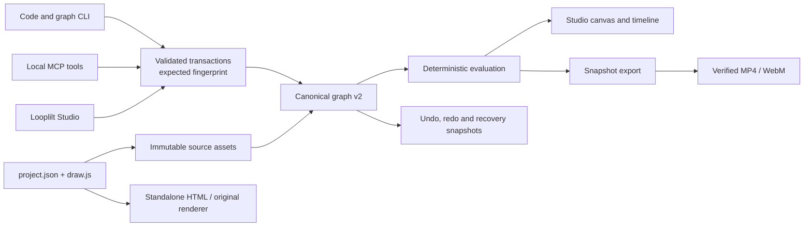

# Architecture

Looplilt has one canonical scene graph for Studio, graph commands, MCP and composition exports. Existing two-file Canvas films remain supported without migration. Importing one into a graph preserves its original source as verified assets.

## The authoritative document

A `project.looplilt.json` contains the hierarchy, timing, animation, effects, behaviors, assets and project settings. Stable node IDs connect selection, timeline clips, inspector fields and agent operations. Timeline lanes are derived views, not another saved project model.

`GraphWorkspace` owns ordinary files in an explicitly selected directory. The local Studio companion and MCP both use it. The browser workspace implements the same transaction contract in IndexedDB for the hosted editor. These are two storage choices; the browser does not silently maintain a competing copy of a local companion project.

Every edit supplies the fingerprint of the state it inspected. One validated transaction creates a revision or returns a conflict. Disk edits use a per-project lock, immutable recovery snapshots, flushed temporary files and atomic publication. A checksum-verified journal is selected by the current fingerprint. A stale operation cannot overwrite a newer human or agent edit. Focused Studio drafts remain visible after a conflict.

The companion polls an inexpensive file-identity and timestamp hint. It reads and verifies the graph when that hint changes. Metadata is never accepted as an edit precondition: transactions still compare the complete document fingerprint.

## Shared evaluation and rendering

`compileGraph` snapshots validated data once per revision. Absolute-time evaluation applies source-clock keyframes, reusable behaviors, constraints, inherited transforms and transitions. Rational rates and offsets preserve fractional timing. `evaluateNode` uses the same semantics while visiting only the required dependency closure.

`CanvasGraphRenderer` handles hierarchical composition, masks, effects, clipping and blend modes. Frames publish only after all required media is ready. Studio preview, browser export and the native graph render host use this compositor. Trusted hosts can register versioned node metadata, behavior evaluators and Canvas painters; project JSON cannot install code.

Video and audio media use verified content hashes and bounded reads. Export samples exact output timestamps, mixes the score and audio automation, then encodes through WebCodecs. The native render host retains an immutable graph snapshot while editing continues. A serial job queue, scoped staging files, cancellation and complete media verification protect published outputs.

See [scene-graph contracts](scene-graph.md), [Studio](studio.md) and [MCP](mcp.md).

## Preserved Canvas workflow

The original `project.json` and `draw.js` workflow still builds standalone HTML and renders through Chromium and FFmpeg. Named scenes, exposed parameters, musical patterns, narration and pure-time drawing helpers retain their original meanings.

The source adapter stores the exact original bytes. Drawing runs in a terminable worker inside an opaque, network-blocked iframe; it is not executed in Node. A source layer can be trimmed, transformed, masked and mixed with editable graph layers. Arbitrary drawing instructions do not become individually editable vector objects.

The maintained frame and audio implementations are shared with the generated browser worker runtime. `npm run check:generated` rejects drift. Compatibility checks compare actual RGBA frames and PCM bytes against the original implementation, including reverse seeks.

The original renderer streams a bounded ordered batch of PNG frames to FFmpeg without writing per-frame files. Standalone HTML carries score data and synthesis code; audio is generated on demand. `build --audio pcm` retains the explicit embedded-audio option.

## Interfaces and boundaries

| Surface | Responsibility |
| --- | --- |
| Graph schema and registry | Bounded JSON, stable IDs, versioned metadata, dependency validation and forward preservation. |
| Transactions and workspaces | Revision checks, atomic publication, undo/redo, recovery and portable bundles. |
| Studio | Visual composition, media library, timeline, motion controls, playback, project management and export. |
| Companion | Authenticated 127.0.0.1 access to one chosen workspace, with Host and Origin validation. |
| MCP | Scoped structured tools for creation, inspection, editing, comparison, readiness and render jobs. |
| Render host | Read-only retained snapshot, allowlisted media access and the same static Studio renderer. |
| Asset adapters | Hash verification, bounded media access, exact relinking and immutable source preservation. |
| Build and distribution | Static Studio output, source fingerprints, asset checksums and verified release packaging. |

MCP exposes no shell, universal JavaScript evaluator, arbitrary filesystem API or remote-media downloader. The companion token belongs in the private local URL and session storage, not a public project or log. The hosted editor requires no account and does not upload projects to a rendering service.

## Resource and compatibility limits

The renderer currently targets 2D animation and media composition. Canvas 2D and WebCodecs capabilities vary by browser; Chrome and Edge are the primary export targets. Software browser graphics remain available. No GPU speedup is claimed without a corresponding measurement.

Bounded queues, export-size budgets and operation deadlines limit resource use. A forcibly killed process can leave an owned temporary directory or an edit lock; recovery never guesses that another process's lock is stale. Browser-local storage is not a substitute for saving a portable project.

The toolkit uses pinned dependencies for browser automation and MCP. Studio has its own locked frontend workspace. Chromium, FFmpeg and FFprobe remain separately installed for native media rendering. Source checkouts build Studio explicitly; matching release bundles include its verified static runtime.

The earlier [engineering report](evolution/REPORT.md) and [decision record](evolution/DECISIONS.md) describe v0.3. Their measurements remain historical baselines, not claims about the new Studio path.
